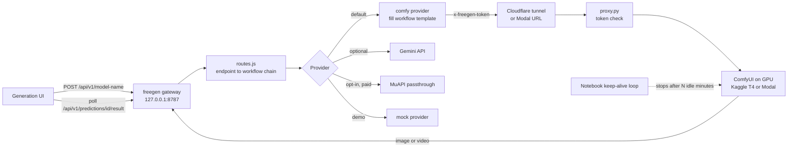

# freegen

A local HTTP gateway that speaks the same API as MuAPI (a paid image and video generation
service), so an open-source generation UI built for MuAPI can run on free GPU backends
instead. Requests are routed to ComfyUI workflows running on a free Kaggle T4 notebook or
on Modal's serverless GPUs.

## The problem

[Open-Generative-AI](https://github.com/Anil-matcha/Open-Generative-AI) is an open-source
UI for image and video models, but every request goes to a paid API. Open-weight models
(FLUX.2 klein, Qwen-Image, Wan 2.2, LTX-2) can do most of the same jobs on free GPU hours.
The UI should not need to change to use them, and the free GPU should not burn its weekly
quota while nobody is generating.

## How it works



1. The UI posts a request to `/api/v1/<model>` and polls `/api/v1/predictions/<id>/result`,
   exactly as it would with MuAPI.
2. `gateway/routes.js` maps each of about 230 UI model endpoints to an ordered list of
   open-weight workflows. Endpoints not in the table are classified from their name and
   payload, so new vendor models added to the UI still get a route.
3. The first workflow in the chain whose model files are loaded on the attached backend
   wins. The gateway fills the ComfyUI API-format prompt, submits it, and serves the result
   back in MuAPI's response shape.
4. The GPU side runs ComfyUI behind a small token-checking reverse proxy (`comfy/proxy.py`)
   and a Cloudflare quick tunnel (Kaggle) or Modal's HTTPS endpoint.

## Features

- Drop-in API compatibility: same endpoints, request fields, polling flow, and error shape
  as MuAPI, so the UI needs only a base URL change.
- 19 ComfyUI workflows (text to image, image edit, background removal, text and image to
  video, first and last frame, lip sync, image and video upscale) with a machine-readable
  manifest of their input bindings.
- One-command Kaggle launch (`scripts/kaggle-launch.sh`): pushes the notebook as a private
  GPU kernel, waits for it to report its tunnel URL, and attaches the gateway.
- Self-stopping notebook: with `IDLE_MINUTES` set, the keep-alive cell stops ComfyUI after
  that many minutes with an empty queue, which saves the weekly GPU quota.
- Model profiles (`image`, `video-5b`, `video-14b`, `ltx`, and others) that pick which
  weights to download based on the GPU's VRAM and disk.
- Paid passthrough is off by default. Unrouted endpoints return 404 unless
  `FREEGEN_ALLOW_PAID=1` is set.
- Security choices: the gateway listens on `127.0.0.1` only, refuses admin config writes
  from non-loopback origins, never saves the caller's API key to disk or returns it, serves only
  media folders, and requires a per-session token on the public tunnel.
- `freegen` CLI: `status`, `routes`, `set-backend <url> [token]`, `set-providers`.

## Skills demonstrated

| Area | Where it shows up |
| --- | --- |
| API design and integration | Reimplementing a third-party REST contract (submit, poll, upload, error shape) |
| Systems integration | Routing one client to several backends with fallback order and capability checks |
| Automation | Scripted Kaggle kernel push, tunnel hand-off, and backend attach |
| Cost and resource control | Idle auto-stop, scale-to-zero on Modal, paid calls off by default |
| Security basics | Token-gated tunnel, loopback-only admin, API keys kept out of saved job records and API responses |
| Testing | 28 tests with Node's built-in test runner (protocol, routing, workflow bindings) |
| Documentation | Setup for each backend, model mapping table, known limits |

## Tech stack

- Node.js 20+ with no runtime dependencies (`node:http`, `node:test`)
- Python 3 standard library for the proxy and notebook
- ComfyUI, Kaggle Notebooks (T4), Modal (serverless GPU), Cloudflare quick tunnels
- Playwright (dev dependency, only for the UI end-to-end script)

## How to run

```bash
npm start                    # gateway on http://127.0.0.1:8787
FREEGEN_MOCK=1 npm start     # demo mode, no GPU needed (returns placeholder media)
npm link                     # optional: global `freegen` command
```

Point the UI at the gateway by setting its MuAPI base URL to `http://127.0.0.1:8787`.

**Free GPU on Kaggle**

```bash
scripts/kaggle-launch.sh video-5b     # needs the Kaggle CLI logged in
```

Or upload `comfy/notebooks/freegen_comfyui.ipynb` to Kaggle (GPU T4, internet on), run all
cells, and paste the printed `freegen set-backend <url> <token>` line into a terminal.

**Larger models on Modal**

```bash
pip install modal && modal setup
modal secret create freegen-token FREEGEN_TOKEN=$(openssl rand -hex 16)
modal secret create huggingface HF_TOKEN=<your Hugging Face token>   # gated models only
modal run comfy/modal_comfyui.py::download --profile video-14b
FREEGEN_GPU=L4 modal deploy comfy/modal_comfyui.py
freegen set-backend <printed Modal URL> <the token>
```

Configuration is read from environment variables first, then `data/config.json` (created
at runtime and gitignored). Keys such as `MUAPI_API_KEY` and `GEMINI_API_KEY` are only
needed for the optional paid or Gemini providers.

## Tests

```bash
npm test                              # no GPU needed
node scripts/validate-workflows.js    # validates every built prompt against a running ComfyUI
node scripts/e2e-ui.mjs               # drives the real UI against the gateway (Playwright)
```

Latest run: 28 tests, 27 passed, 1 skipped (the ComfyUI integration test skips when no
local ComfyUI is running).

## Limitations

- Open-weight models are noticeably below the best commercial video and image models in quality.
- A Kaggle T4 (15 GB) fits the image profile and Wan 2.2 5B. Wan 14B, LTX-2, and
  InfiniteTalk need 24 GB or more; LTX-2.5 needs an A100.
- The Modal app and the notebook were written against current documentation but have not
  been run end to end on a GPU yet. First runs may need small fixes.
- The Kaggle hand-off posts the tunnel URL and token to a random ntfy.sh topic. The topic
  name is the only secret, so treat a running backend as semi-public and stop it when done.
- Audio models, motion control, and video-to-video lip sync have no free route and stay on
  paid passthrough.

## Third-party code and licenses

- `comfy/templates-ui/` holds copies of official ComfyUI workflow templates from Comfy Org
  (MIT, license included in that folder). `comfy/workflows/*.api.json` are exported from
  them and include their default prompt text.
- ComfyUI (GPL-3.0) and the SeedVR2 upscaler node (Apache-2.0) are cloned at runtime on the
  GPU backend. They are not included in this repository.
- Model weights are downloaded from Hugging Face at runtime and keep their own licenses.
  Some (Qwen-Image-2.1, LTX-2.5) are gated and require accepting the license first.
- Open-Generative-AI is a separate project and is not included.

## Repository layout

```
gateway/            MuAPI-compatible server, providers, CLI, tests
comfy/workflows/    API-format ComfyUI prompts plus manifest.json bindings
comfy/models.json   weight files and URLs per workflow
comfy/notebooks/    Kaggle/Colab notebook (and a .py twin)
comfy/modal_comfyui.py  Modal app (download and serve)
comfy/proxy.py      token-checking reverse proxy
scripts/            workflow export and validation, notebook builder, Kaggle launcher, UI e2e
```

## License

MIT, see `LICENSE`. Third-party files keep their own licenses as listed above.
